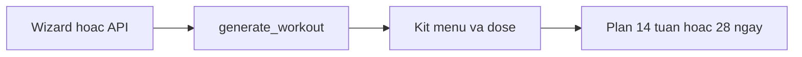

# Plan kiểm thử toàn hệ thống TAPTOT

Căn cứ code tại thời điểm lập lại plan, 2026-11-12: API `/api/v1` và Next.js `frontend`. Khách hàng là khách vãng lai. Ba tài khoản đăng nhập được là `admin`, `hlv`, `ctv`. Role `user` còn trong database nhưng không đăng nhập. Cửa hàng không còn chọn loại dụng cụ.

Bộ case vai trò đã có nằm ở [full-role-flow-testcases.md](full-role-flow-testcases.md). Báo cáo chạy 2026-11-07 nằm ở [full-role-flow-report.md](full-role-flow-report.md). File này không viết lại các case đó. Case mới nằm ở [domain-edge-testcases.md](domain-edge-testcases.md).

Một case chỉ Pass khi expected khớp một lần chạy: pytest, Playwright, hoặc thao tác trên app. Đọc code không tính Pass.

## Phạm vi

Trong phạm vi:

- Khách vãng lai, admin, HLV, CTV.
- Gen lịch Nhập môn (28 ngày) và Thử thách 100 ngày (14 tuần).
- Lịch tự tạo của khách và của HLV.
- Shop một dòng và nhiều dòng, promo, vé chống đẩy và plank, tem kích hoạt, SePay.
- Dinh dưỡng gắn với lịch đã gen.
- Catalog bài tập và món ăn ở mức làm sai giáo án hoặc sai năng lượng.

Ngoài phạm vi, giữ như bộ case cũ:

- Đăng nhập Google hoặc Facebook.
- Hoa hồng chi trả cho CTV. Không có ví CTV. `discount_vnd` là tiền giảm của khách.
- Router `/api/v1/payments/*` không được mount.
- Bài tải lớn. Ngưỡng rate limit chỉ ghi nhận: checkout 10/phút/IP, track 20/phút/IP, generate 8/phút/IP.

## Vai trò

| Vai | Vào được | Không được |
|---|---|---|
| Khách | Catalog, giỏ local, đặt hàng, tra cứu đơn, wizard lịch, share và PDF, góp ý, lead, sự kiện | Đăng ký, login role `user`, `/my-plans`, đơn admin |
| HLV | Lịch của mình, bài tập riêng, sửa catalog trong quyền, upload | Đơn, stats, CTV, bài nấu, nội dung site, lịch HLV khác |
| Admin | Mọi thứ của HLV, cộng nhân sự, đơn, tem, stats, lead, site | Ghi bằng cookie khi chưa step-up mật khẩu 10 phút |
| CTV | Mã và stats của mình | Sửa mã, lịch, đơn admin, catalog |

Đăng ký công khai đóng. Admin tạo HLV bằng `POST /admin/staff` và tạo CTV bằng `POST /admin/collaborators`.

## Cách chấm

Mức nghiêm trọng tính theo người tập hoặc tiền hàng.

| Mức | Khi nào | Ví dụ |
|---|---|---|
| Blocker | Lộ quyền, bán âm tồn, calo dưới sàn giới tính, bài trái chỉ định khi hệ thống đã nhận ghi chú chấn thương | HLV sửa lịch người khác được 200; nữ 70 kg bị giao 900 kcal |
| Critical | Volume tuần vượt trần sau hệ số tier, mất tuần deload, bài sai kit, sai tổng tiền, nhảy trạng thái giao hàng | Lịch dây có ghế đẩy tạ đơn; thu 450000 trong khi công thức ra 350000 |
| Major | Sai split theo giới hoặc số buổi, nghỉ lệch thang, người mới được 6 buổi, macro lệch dải, hủy đơn đã thu mà không có vết hoàn tiền | Nam 3 buổi ra LUL; level 1 lưu 6 buổi |
| Minor | Chữ RPE bị xóa, tuần B trùng tuần A vì hết bài thay, copy coach cố định, các khối dinh dưỡng cùng một mục tiêu calo dù chữ trên UI nói theo pha | Không có field `rir`; ba câu tư vấn cứng |

Priority trên từng case là thứ tự chạy, không thay mức nghiêm trọng của defect tìm được.

## Đã biết, không ghi Pass

- **BUG-001 / KNOWN-ADM-008.** `ShopService.update_order_status` gán thẳng trạng thái fulfillment nếu đơn chưa `cancelled` hoặc `returned`. Nhảy `awaiting_confirm` → `completed` và đi lùi đều được. Expected của case vẫn là từ chối bước nhảy. Test `test_admin_cannot_skip_or_reverse_fulfillment_states` đang xfail. Quan sát thấy nhảy được thì ghi Fail đúng BUG-001, không đổi expected thành “cho phép nhảy”.
- Ghi chú hồ sơ trên `GET /plans/share/{token}` là công khai. Xác nhận chuỗi còn trong body. Ghi rủi ro riêng tư, không Pass như dữ liệu kín.
- Wizard thử thách gửi `health_note: null` và `extra_goals: []`. Lọc gối, vai, lưng không chạy từ UI. Lọc tuổi từ 45 vẫn chạy nếu request có `age`. Không Fail API vì UI không gửi ghi chú. Ghi rủi ro sản phẩm nếu người dùng không có chỗ khai báo chấn thương.
- Server vé chống đẩy và plank không xem camera. `reps` trong trần thời gian là đủ để ra vé. Không Pass như kiểm tra kỹ thuật chống đẩy.
- Pytest SQLite không khóa dòng tồn. Không dùng kết quả SQLite để kết luận an toàn khi hai đơn cùng lúc. Kết luận đó chỉ có trên Postgres.

## Môi trường và dữ liệu

Dùng lại mốc của bộ case cũ.

- Người nhận: `Nguyen Van A`, `0901234567`, `Hà Nội`, `Phường Bến Nghé`, `12 Le Loi`. Quận bỏ trống vẫn hợp lệ. `84901234567` thành `0901234567`.
- Sản phẩm mẫu một dòng: `QA-KIT`, `price_vnd = 500000`, `stock_qty = 10`, `is_active = true`. Phí ship luôn 0 và không cộng vào `total_vnd`.
- Ba kit công khai khi case nhiều mặt hàng: `day-khang-luc`, `ta-don`, `xa-don-va-vong-treo`. Alias `resistance-band`, `dumbbell`, `bar-and-rings`.
- Mã CTV `CTVQA`, 10%. Idempotency-Key 16–128 ký tự `[A-Za-z0-9._:-]`.
- Gen thử thách trên môi trường bật `require_redeem_code_for_generate` cần mã. Mã test `1` chỉ để mở cổng, không dùng cho case đốt tem. Case đốt tem dùng mã `TT-` unused thật.
- `food_ids` lấy từ catalog đang seed. Không bịa `food_id`. Muốn tự chọn món thì `ai_suggest_foods = false` và pool đủ 2 đạm, 2 tinh bột, 2 rau, tối đa 30 món.
- App local chỉ để chấm UI và body mà wizard thực sự gửi. SePay hoặc Turnstile thiếu secret thì nhánh đó là Blocked, nhánh còn lại của cùng case vẫn chấm.

Công thức tiền, tính trên subtotal gốc, không nhân kế tiếp:

- `event_vnd = subtotal * round(event_percent * 10) // 1000`
- `promo_vnd = subtotal * promo_percent // 100`
- Nếu tổng giảm vượt subtotal thì cắt promo trước, rồi cắt event. Thu không âm.

| Tình huống | Subtotal | Event | Promo | Thu |
|---|---:|---:|---:|---:|
| COD + CTV 10% | 500000 | 0 | 10 | 450000 |
| 100 rep (20%) + CTV 10% | 500000 | 20 | 10 | 350000 |
| 1 rep (0.2%) + CTV 10% | 500000 | 0.2 | 10 | 449000 |
| Plank 10% + CTV 10% | 500000 | 10 | 10 | 400000 |
| Event 100% + CTV 10% | 500000 | 100 | 10 | 0 |
| SL 2 + CTV 10% | 1000000 | 0 | 10 | 900000 |

Trạng thái đơn đúng luật nghiệp vụ: `awaiting_confirm` → `packing` → `shipping` → `completed`. Đóng: `cancelled`, `returned`. Hủy được từ `awaiting_confirm`, `placed`, `packing`, `shipping`. Trả được từ `shipping`, `completed`. Đơn `completed` không hủy. Đơn đã đóng không sang `completed`.

## Lớp 1 — Hồi quy luồng vai trò

Chạy lại, không thiết kế lại.

- Pytest: `test_four_role_full_flow.py`, `test_shop_checkout.py`, promo, redeem, auth cookies, admin stats, `test_main_flow_regression.py`, `test_pushup_challenge.py`.
- Playwright: `public`, `content`, `shop-cod`, `shop-guest`, `plan`, `plan-guest`, `contact-feedback`, `staff`.

Bao phủ sẵn KH-AUTH, KH-SHOP một dòng, KH-PAY, KH-PROMO, KH-REDEEM, AD-*, HLV shell và bài riêng, CTV stats và redact, XR-01 đến XR-09. Mục Blocked của báo cáo 2026-11-07 (SePay local, Turnstile, camera người thật, wizard bốn bước bấm lưu trên app) giữ Blocked nếu môi trường vẫn thiếu. Không đổi thành Fail.

## Lớp 2 — Gen lịch

Engine là luật tất định trong `api/app/services/workout_generation/service.py`. Route `POST /api/v1/ai/generate-workout-schedule`. Route `/ai` không gọi model ngôn ngữ. Chỉ hai chương trình sống: Nhập môn và Thử thách 100 ngày, tại nhà, đúng một kit.

`POST /plans` và `POST /my-plans` chỉ lưu bài người dùng đã gõ. Không chọn bài.

### Split

`schedule_spec_master._week_code`. Giới và số buổi quyết định. Kinh nghiệm không đổi mã tuần. Sau khi kẹp số buổi:

| Buổi | Nam | Nữ |
|---:|---|---|
| 2 | UL | Lower, Upper |
| 3 | PPL | LUL |
| 4 | ULUL | LPPL |
| 5 | PPLUL | LULU, Cardio-Core |
| 6 | PPLPPL | Lower, Upper, Lower, Upper, Lower, Upper |

Người mới (`effective_level` ≤ 1 hoặc tier `weak`) tối đa 5 buổi. Level khác tối đa 6. Schema nhận tới 7; policy kẹp xuống. Nam 5 buổi còn PPLUL là đúng bảng, không gọi là lệch split. `allow_ppl_x2` luôn false nhưng nam 6 buổi vẫn là PPLPPL theo bảng. Ghi nhận, không Fail vì câu chữ policy.

### Volume tuần

Ngân sách hard set / tuần trước hệ số, `weekly_volume._BUDGET`. Cột là min / target / max.

| Level | Ngực, lưng, đùi, hinge | Vai | Tay trước | Tay sau | Core |
|---:|---|---|---|---|---|
| 1 | 6 / 8 / 12 | 6 / 8 / 12 | 0 / 4 / 8 | 0 / 2 / 6 | 0 / 4 / 8 |
| 2 | 6 / 9 / 14 | 4 / 6 / 10 | 0 / 3 / 6 | 0 / 3 / 6 | 0 / 6 / 10 |
| 3 | 8 / 10 / 16 | 4 / 8 / 12 | 2 / 4 / 8 | 2 / 4 / 8 | 0 / 6 / 12 |

Hệ số tier: `weak` 0.8, `ok` 1.0, `strong` 1.1. Làm tròn từng đầu bằng `round`, sàn 0. Claimed level ≥ 3 mà ít hơn 2 bài test thì thêm `conservative_volume` và nhân tiếp 0.85. Focus đúng nhóm thì max cộng 2 và min cộng 1, min không vượt max.

Đếm hard set ở section `main` của tuần không deload. Vượt max sau hệ số là Critical. Tuần deload loại khỏi so sánh trần này vì set đã bị cắt khoảng 60%.

Trần set một buổi level 1: 14 set ở 45 phút, cứng 16. Hàm `l1_session_set_cap`: phút bị kẹp 45–60 rồi `round(14 * phút / 45)`, rồi kẹp 8–16. 60 phút ra 16.

### Set, rep, nghỉ, deload

- Set mỗi bài sức: sàn 2. Trần 3 nếu level ≤ 1, trần 4 nếu level ≥ 2. Ngoại lệ bài test (compound sức đầu, không phải core): pha 1 = 3 set, pha 2 = 4 set, pha 3 = 3 set, kể cả level 1.
- Level ≤ 2 dùng profile Novice: không tự cộng set (`set_ramp_from_week = 99`). Level 3 dùng Developing: cộng tối đa 1 set từ tuần 4 trong pha, mỗi 3 tuần, trần challenge vẫn 4. Tier `weak` hạ một profile, nên level 3 yếu về Novice và không cộng set.
- Rep compound xoay quanh tâm level: level 1 tâm 10, level 2 tâm 8, level 3 tâm 6, biên ±2, kẹp 5–20. Isolation biên rộng hơn. Mục tiêu `gain_weight` hoặc `gain_muscle` đi từ đầu khoảng rep tới cuối khoảng ở tuần không deload, tuần deload về đầu khoảng. `lose_weight` và `maintain` giữ khoảng, không đi lên.
- Nghỉ gốc: compound level 1 là 120 giây, compound level khác 180, sàn compound 120, isolation 90, conditioning 90, mobility 60, nghỉ giữa khởi động 30, cardio liên tục 0. Thang hợp lệ 0, 30, 45, 60, 90, 120, 150, 180, cộng 20 giây cho nhịp cooldown.
- Deload tuần 4, 8 và 14. Set = `max(2, round(set * 0.6))` khi set trước deload lớn hơn 1. Nghỉ nhân 1.15 với Novice (level ≤ 2, và level 3 nếu tier `weak`), nhân 1.20 với Developing (level 3, tier không yếu), rồi `min(180, …)` và chốt lại thang. Ghi chú deload nói giữ mức tạ, tập ít hiệp hơn.
- 45 và 60 phút đều 5 slot sức. 60 phút chỉ chuyển set sang nhóm focus, không thêm bài. Focus tối đa 3 trong `nguc`, `lung`, `mong`, `chan`, `bung`, `vai`, `tay`. Vùng thứ tư bị cắt khỏi danh sách, request không vì thế mà 422.
- Khởi động: một bài chung 2 × 20–30 giây, rồi primer cùng bài chính đầu, 2 set khoảng nửa rep làm việc, nghỉ primer 90 giây.
- Không ghi `rir` số. Câu “còn dư 2–3 cái” là chữ, không phải field. Phase text xóa `RPE n`. Thiếu field RIR là Minor, không phải Blocker.

### Kit

Đúng một kit. `no_equipment`, `location=gym`, kit lạ, `free_home`, `fitness_advanced`, `fitness_soldier` bị từ chối trước khi tạo plan. Level ≥ 4 trả 400 `Mức kinh nghiệm trên 12 tháng đang được phát triển`.

Neo cố định:

- Tạ đơn: bench, row, goblet squat.
- Dây: press, pulldown, squat.
- Xà và vòng: hít đất, kéo xà, squat.

Lịch dây không có ghế đẩy tạ đơn hay kéo xà. Lịch tạ đơn không có muscle-up. Lịch xà và vòng không có inverted row trên bàn.

### An toàn

`parse_injury_constraints(health_note, age)`:

- Tuổi ≥ 45, kể cả ghi chú trống: cấm nhảy, plyo, kipping, burpee, box jump, high knees, pistol. Jumping jack thuộc nhóm nhảy.
- Gối (`goi`, meniscus): cấm squat và nhảy.
- Vai (`vai`, rotator): cấm đẩy qua đầu.
- Lưng (`lung`, cột sống, đĩa đệm, thoát vị): cấm hinge.

Từ khóa phải nằm trong `health_note` của request. UI không gửi field này thì case UI ghi rủi ro, case API với note có chữ vẫn phải lọc.

### Dinh dưỡng

Mifflin–St Jeor trên cân, cao, tuổi, giới. Nữ trừ 161, nam cộng 5.

- `tdee_base = int(bmr * hệ số vận động)`. `int` cắt phần thập phân, không làm tròn.
- Hệ số: sedentary 1.2, light 1.375, moderate 1.55, active 1.725, very_active 1.9. Activity lạ rơi về 1.375.
- Cộng thêm `round(buổi * phút * 5 * kg / 60 / 7)`. `round` của Python, half to even.
- Giảm cân trừ `round(kg_tuần * 7700 / 7)`. Tăng cân cộng cùng số. `gain_muscle` cộng phẳng 300. Giữ cân cộng 0.
- Kg/tuần mặc định khi không gửi: giảm khoảng 0.75% cân, kẹp 0.5–1.0% và 0.2–1.5 kg; tăng khoảng 0.5% cân, kẹp 0.25–0.75% và 0.1–1.5 kg. Bước làm tròn 0.05 kg.
- Sàn ngày = `max(1200 nếu nữ, 1500 nếu nam, round(bmr))`. Giảm cân kẹp trong `[sàn, TDEE]`. Tăng cân kẹp trong `[TDEE, TDEE+500]`.
- Đạm 1.8 g/kg khi giảm hoặc giữ, 2.0 g/kg khi tăng, rồi kẹp 1.6–2.0 g/kg. Béo xuất phát 0.7 / 0.8 / 0.9 g/kg theo giảm, giữ, tăng, và bị kẹp khoảng 20–30% năng lượng. Carb là phần còn lại, không về 0.
- 4 bữa nếu mục tiêu ≥ 1800 kcal, không thì 3. Ngày tập và ngày nghỉ cùng kcal. Khẩu phần bữa lệch mục tiêu quá 10% là lệch dinh dưỡng.
- Khối 4 tuần của thử thách dùng cùng mục tiêu UI. `phase_calorie_target` cố ý không bước ±50 hoặc ±100. Các khối cùng một số calo là đúng code. Chỉ ghi Minor nếu chữ trên plan hứa mỗi pha một mức calo khác số đã lưu.
- Ví dụ kiểm được, nam 25 tuổi, 170 cm, 70 kg, moderate, 3 buổi, 45 phút, giảm cân, không gửi `kg_per_week`: BMR 1642.5, TDEE 2545 + 112 = 2657, mặc định 0.50 kg/tuần, trừ 550, mục tiêu 2107 kcal, đạm 126 g, béo 49 g, carb 290.5 g, 4 bữa. Đổi buổi hoặc phút thì tính lại, không lấy cứng 2107.

Nhập môn: `duration_weeks = 4`, `sessions_per_week = 3`, `session_minutes = 45`. Không dùng menu kit 100 ngày. Trần miễn phí 3 lần/thiết bị/ngày và 5 lần/IP/ngày theo `Asia/Ho_Chi_Minh`, chỉ khi secret Turnstile được cấu hình. Thiếu `x-device-id` dạng UUID thì từ chối ở nhánh đó. Đếm tăng sau khi plan được tạo; nhiều request song song trước lúc ghi nhận có thể cùng lọt. Đó là rủi ro, kỳ vọng sản phẩm nên từ chối request thứ tư của cùng thiết bị trong ngày.

## Lớp 3 — Mua hàng ít đụng

Checkout là cả giỏ hoặc không gì cả. Postgres khóa dòng sản phẩm `FOR UPDATE` theo id. SQLite bỏ khóa. Giá lấy từ `price_vnd` lúc commit. Body khách không được gửi giá bán. Một mã `TT-` cho mỗi đơn vị, alphabet không có I, L, O, 0, 1. JSON khách và track không có `gift_codes`.

Một sản phẩm là một dòng giỏ. `shop_products` không còn `options_json`. `shop_cart_items` không còn `option_key`. Unique là `(user_id, product_id)`. Thêm cùng sản phẩm hai lần thì cộng `quantity`, không tách dòng. Tổng quantity vượt `stock_qty` thì 409 và tồn không đổi. Giỏ khách trong `localStorage` cũng gộp theo `product_id`.

Thẻ trên `/mua-dung-cu` có mức độ, tên, số còn, Xem chi tiết, giá và nút Thêm vào giỏ. Chữ trong thẻ căn giữa. Không có radio chọn loại. Trang chi tiết vẫn có nút Thêm vào giỏ và không hỏi kích thước. Toast là `Đã thêm {tên sản phẩm} vào giỏ`.

Idempotency cùng key và cùng body thì replay, trừ tồn một lần. Cùng key khác body thì 409 `idempotency_conflict`. Fingerprint checkout là `shop-checkout-v2` và không còn khóa lựa chọn. Mọi khách chưa login dùng chung scope `guest`.

Vé chống đẩy: 0.2% mỗi rep, trần 100 rep = 20%, một lần. Plank ≥ 55 giây trong 30 phút = 10%, rep bị ép 0. Dưới 55 giây không có vé plank.

CTV: `order_count` bỏ đơn hủy; `total_vnd` và `discount_vnd` chỉ đơn `completed`. Stats CTV cắt ngày theo giờ Việt Nam. Bảng tháng admin cắt theo UTC. Một đơn 00:30 giờ Việt Nam có thể rơi vào ngày UTC hôm trước trên stats admin và vẫn thuộc ngày Việt Nam trên stats CTV.

## Lớp 4 — Phân quyền bổ sung

Hồi quy KH-AUTH, AD-AUTH, HLV-DENY, CTV-DENY, XR-06 trước. Case mới chỉ chỗ bộ cũ chưa khóa từng hành động: HLV sửa content lịch người khác, HLV ẩn bài không phải của mình, cookie admin ghi khi chưa step-up. Bearer trong pytest được bỏ qua step-up; case UI phải dùng cookie và kỳ vọng 403 `admin_step_up`, câu `Nhập lại mật khẩu để thao tác quản trị.`

## Lệch lần chạy trước, phải chạy lại

Không ghi Pass. Không viết expected mới cho khớp actual.

- `GET /admin/stats` không còn `kpis.orders_count` và `kpis.orders_gmv_vnd`. Payload hiện là `lifetime`, `order_status`, `products`, `months`. Đơn và doanh thu nằm ở `lifetime.orders` và `lifetime.revenue_vnd`. `test_four_role_full_flow.py` vẫn đọc `kpis` nên KeyError. Case bốn vai ghi actual này, rồi chấm theo `lifetime`.
- Mười test trong `test_workout_generation_integration.py` fail nhưng chưa có traceback vì đĩa đầy. Chạy lại GEN cổng từ chối và thử thách trước khi kết luận.
- Toast e2e cũ tìm `Đã thêm Dây kháng lực vào giỏ` trong khi nhãn lựa chọn từng chèn vào giữa câu. Lựa chọn đã bỏ, toast khớp tên sản phẩm. Chạy lại `shop-guest` và `shop-cod` trước khi giữ Fail.

## Thứ tự chạy

1. Lớp 1, để biết BUG-001 còn xfail và luồng vai trò không gãy. Chấm stats theo `lifetime`, không theo `kpis`.
2. GEN-06 và GEN-07 trước các persona, vì đó là cổng từ chối. Rồi GEN-01 đến GEN-05, GEN-08 đến GEN-12, GEN-13, GEN-14. Chạy lại suite gen đã fail khi đĩa đầy.
3. NUT trên đúng plan của GEN-01, GEN-02, GEN-03. Không gen thêm người nếu persona đã có.
4. MAN, rồi SHOP-M1 đến SHOP-M12 và SHOP-UI. SHOP-M10 chỉ trên Postgres.
5. ROLE-01 đến ROLE-03.

## Tiêu chí vào vòng chạy

- Bộ case này và bộ vai trò cũ đều có expected đo được.
- Có catalog ba kit và một pool món `ai_eligible` đủ nhóm, hoặc người chạy liệt kê `food_ids` thật trước lúc gen.
- Môi trường ghi rõ: SQLite pytest, Postgres, app local, SePay có key hay không, Turnstile có secret hay không.

## Tiêu chí xong một vòng

- Mỗi case mới có trạng thái Pass, Fail, hoặc Blocked. Không có ô trống. SHOP-UI nằm trong danh sách này.
- KeyError `kpis`, mười test gen chưa có traceback, và toast e2e cũ không được ghi Pass nếu chưa chạy lại.
- BUG-001, ghi chú share, vé không camera, wizard không gửi chấn thương không bị làm tròn thành Pass.
- Fail có mức nghiêm trọng, bước tái hiện, expected, actual. Blocked nói thiếu gì.
- SQLite không được dùng làm bằng chứng của SHOP-M10.

## Ghi defect

Mỗi lỗi: tiêu đề, môi trường, precondition, bước, expected, actual, mức, priority, bằng chứng, tái hiện được hay không. Không nâng expected cho khớp actual.
